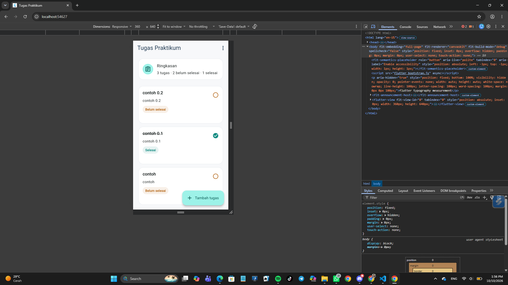
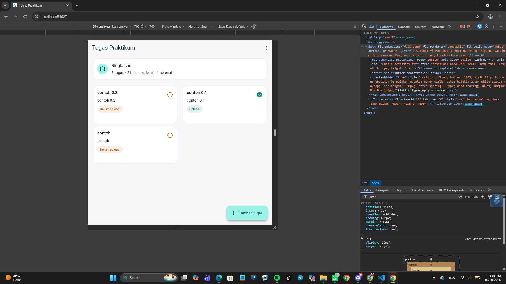

# UTS Praktikum Pemrograman Perangkat Bergerak

- **Nama**: Khairan Adiokta Arun Nugraha
- **NIM**: 362558302097
- **Kelas / Prodi**: 2C / Sarjana Terapan TRPL
- **Mata Kuliah**: Pemrograman Perangkat Bergerak (Semester 3)

---

## Jawaban Teori

1. Daftar Tugas dan UI Responsif

Di halaman awal ketika kita membuka aplikasi ini menampilkan judul, mata kuliah, status selesai/belum, dan ringkasan jumlah tugas. Jika belom ada tugas yang muncul, maka akan tampil empty state, "Belum ada tugas". Nah layout responsif dari aplikasi ini memakai LayoutBuilder: lebar lebar ≥ 700px untuk ukuran tablet 2 kolom, lalu dengan lebar 360px untuk ukuran handphone 1 kolom. Lalu grid memakai GridView.builder dengan SliverGridDelegateWithFixedCrossAxisCount dan teks dibungkus dengan Expanded, maxLines, dan TextOverFlow.ellipsis agar tidak overflow.

2. Form, Validasi, dan Navigasi

Form tambah tugas memakai Form, GlobalKey<FormState>, dan dua TextFormField dengan validator yang memakai trim(), agar input hanya spasi dianggap kosong. Saat Simpan, form divalidasi lalu Task dikembalikan melalui Navigator.pop(context, task). saat Batal, halaman ditutup tanpa mengubah daftar. Navigasi ke form dan halaman detail memakai Navigator.push, dan halaman detail menerima objek Task yang dipilih.

3. State dan Interaksi Daftar

Perubahan daftar dikelola melalui _addTask() dan _toggleTask() yang memakai setState(), sehingga tugas baru langsung muncul dan status selesai/belum selesai dapat diubah. Setelah perubahan, data disimpan melalui _storage.save(). Ringkasan tugas dihitung dari _tasks.length dan jumlah tugas yang isDone, sehingga daftar dan ringkasan ikut terperbarui.

4. Asynchronus dan State UI

Pemuatan data dilakukan secara asynchronous melalui _loadTasks() yang mengatur _isLoading dan _errorMessage. Tampilan utama memakai _buildTaskContent() untuk menampilkan CircularProgressIndicator saat loading, pesan error beserta tombol Coba Lagi saat gagal, empty state saat data kosong, dan GridView saat data tersedia. Tombol Coba Lagi memanggil ulang _loadTasks().

5. Penyimpanan Lokal dan Verifikasi

Model Task memakai toJson() dan fromJson() untuk konversi data, sedangkan TaskStorage memakai jsonEncode() dan jsonDecode() untuk menyimpan serta membaca daftar dari SharedPreferences melalui save(), load(), dan clear(). load() dipanggil di initState() sehingga data dan status tugas tetap tersedia setelah aplikasi direstart. Saya mengguankan flutter run -d web-server --web-port=8080 untuk menjalankan aplikasi, lalu menambah tugas, menutup, dan membuka ulang aplikasi untuk memastikan data tetap tersimpan.


## Cara Menjalankan Aplikasi

1. Buka folder flutter di teks editor kesayangan kalian, Saya biasa menggunakan VSCode.
2. Pastikan flutter SDK tersedia, lalu
3. Buka terminal dan jalankan perintah

```sh
flutter pub get
flutter run -d web-server --web-port=8080
```
lalu keep perintah tersebut dan gunakan perintah tersebut agar penyimpanan lokal tidak pernah hilang.


## Acceptance Criteria

| Kriteria                                                       | Status   |
| -------------------------------------------------------------- | -------- |
| A. Tampilan telepon pada lebar 360 px tanpa overflow           | Berhasil |
| B. Tampilan tablet pada lebar minimal 700 px dengan dua kolom  | Berhasil |
| C. Validasi judul dan mata kuliah                              | Berhasil |
| D. Navigasi detail, Simpan, dan Batal                          | Berhasil |
| E. Daftar dan ringkasan diperbarui setelah perubahan state     | Berhasil |
| F. Loading, empty state, data, error, dan Coba Lagi            | Berhasil |
| G. Data serta status tetap ada setelah aplikasi dibuka kembali | Berhasil |
| H. Aplikasi berjalan dan hasil pemeriksaan kode dicatat        | Berhasil |


## Ringkasan Satu Alur Kode

Alur yang dipilih: penyimpanan dan pemulihan daftar tugas.

1. Users menambahkan atau mengubah tugas melalui halaman utama.
2. Bagian aplikasi yang mengelola daftar tugas memperbarui data.
3. Fungsi penyimpanan menerima daftar tugas.
4. Setiap objek `Task` diubah menjadi representasi JSON menggunakan `toJson()`.
5. Data JSON disimpan ke SharedPreferences.
6. Ketika data dibutuhkan kembali, fungsi `load()` membaca JSON dari penyimpanan.
7. Data JSON diubah menjadi objek `Task` menggunakan `fromJson()`.
8. Daftar hasil yang disimpan tidak akan hilang ketika aplikasi direstrat, karena sudah tersimpan di local storage.


### Bukti Keluaran

* Keluaran `flutter analyze`:
```sh
PS C:\CoolYeah\Semester 3\pemrogramanperangkatbergerak\starter-uts> flutter analyze                      
Analyzing starter-uts...                                                
No issues found! (ran in 33.6s)
```
* Keluaran `flutter test`:
```sh
PS C:\CoolYeah\Semester 3\pemrogramanperangkatbergerak\starter-uts> flutter test                         
00:17 +0: menampilkan keadaan kosong setelah data selesai dimuat                                                                                                                                                                                                         
══╡ EXCEPTION CAUGHT BY FLUTTER TEST FRAMEWORK ╞════════════════════════════════════════════════════
The following assertion was thrown running a test:
pumpAndSettle timed out

When the exception was thrown, this was the stack:
#0      WidgetTester.pumpAndSettle.<anonymous closure> (package:flutter_test/src/widget_tester.dart:717:11)
<asynchronous suspension>
#1      TestAsyncUtils.guard.<anonymous closure> (package:flutter_test/src/test_async_utils.dart:130:27)
<asynchronous suspension>
#2      main.<anonymous closure> (file:///C:/CoolYeah/Semester%203/pemrogramanperangkatbergerak/starter-uts/test/starter_test.dart:13:5)
<asynchronous suspension>
#3      testWidgets.<anonymous closure>.<anonymous closure> (package:flutter_test/src/widget_tester.dart:192:15)
<asynchronous suspension>
#4      TestWidgetsFlutterBinding._runTestBody (package:flutter_test/src/binding.dart:1953:5)
<asynchronous suspension>
<asynchronous suspension>
(elided one frame from package:stack_trace)

The test description was:
  menampilkan keadaan kosong setelah data selesai dimuat
════════════════════════════════════════════════════════════════════════════════════════════════════
00:17 +0 -1: menampilkan keadaan kosong setelah data selesai dimuat [E]                                                                                                                                                                                                  
  Test failed. See exception logs above.
  The test description was: menampilkan keadaan kosong setelah data selesai dimuat
  

To run this test again: C:\src\flutter\bin\cache\dart-sdk\bin\dart.exe test C:/CoolYeah/Semester 3/pemrogramanperangkatbergerak/starter-uts/test/starter_test.dart -p vm --plain-name "menampilkan keadaan kosong setelah data selesai dimuat"
00:23 +0 -1: error pemuatan menyediakan aksi coba lagi                                                                                                                                                                                                                   
══╡ EXCEPTION CAUGHT BY FLUTTER TEST FRAMEWORK ╞════════════════════════════════════════════════════
The following assertion was thrown running a test:
pumpAndSettle timed out

When the exception was thrown, this was the stack:
#0      WidgetTester.pumpAndSettle.<anonymous closure> (package:flutter_test/src/widget_tester.dart:717:11)
<asynchronous suspension>
#1      TestAsyncUtils.guard.<anonymous closure> (package:flutter_test/src/test_async_utils.dart:130:27)
<asynchronous suspension>
#2      main.<anonymous closure> (file:///C:/CoolYeah/Semester%203/pemrogramanperangkatbergerak/starter-uts/test/starter_test.dart:23:5)
<asynchronous suspension>
#3      testWidgets.<anonymous closure>.<anonymous closure> (package:flutter_test/src/widget_tester.dart:192:15)
<asynchronous suspension>
#4      TestWidgetsFlutterBinding._runTestBody (package:flutter_test/src/binding.dart:1953:5)
<asynchronous suspension>
<asynchronous suspension>
(elided one frame from package:stack_trace)

The test description was:
  error pemuatan menyediakan aksi coba lagi
════════════════════════════════════════════════════════════════════════════════════════════════════
00:23 +0 -2: error pemuatan menyediakan aksi coba lagi [E]                                                                                                                                                                                                               
  Test failed. See exception logs above.
  The test description was: error pemuatan menyediakan aksi coba lagi
  

To run this test again: C:\src\flutter\bin\cache\dart-sdk\bin\dart.exe test C:/CoolYeah/Semester 3/pemrogramanperangkatbergerak/starter-uts/test/starter_test.dart -p vm --plain-name "error pemuatan menyediakan aksi coba lagi"
00:23 +0 -2: Some tests failed.             
```
Penyebab error pada `flutter test` ini adalah pumpAndSettle() menunggu tanpa batas karena masih ada CircularProgressIndicator yang berputar serta Future.delayed dan SharedPreferences yang belum diselesaikan atau dimock di dalam widget test. Alhasil `fultter test` error.


## Bukti Tangkapan Layar (Running App)
| HandPhone | Tablet |
|---|---|
|  |  |

## Error yang Tersisa
- Error pada `flutter test`: 
Test failed. See exception logs above. The test description was: error pemuatan menyediakan aksi coba lagi